<div align="center">

# Willify

### Describe the moment. Hear it.

An AI music DJ that can't make songs up. Describe a moment in a sentence and Willify builds a playlist of real songs from the iTunes catalogue, checked one by one, then plays 30-second previews straight away. Refine it with thumbs and a few words, explore 40 genres in a 3D galaxy, and take the daily clue quiz. No account, no Premium.

**[willify.ewstudios.workers.dev](https://willify.ewstudios.workers.dev)** · [The shared API](https://github.com/emwil23/ew-apps-api)


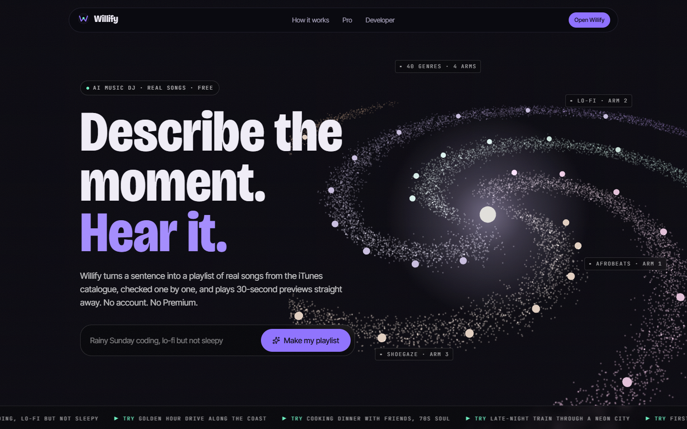

</div>

## The idea

Willify started in 2021 as a Spotify player: search a song, play it in the page. Only Spotify Premium users could play anything, the client ID was hard-coded, and the login server on Heroku has been dead for years. What was worth keeping was the promise, _search a song, play it instantly_, and the name.

So the instant part stayed and the search became a conversation. You describe a moment, an AI suggests songs, and Willify looks every one of them up on iTunes before it reaches you. Language models invent songs with total confidence; here a made-up song simply never shows up. The previews come from Apple, free for anyone, and every song is one tap from Apple Music.

| From                          | What Willify takes                                                       |
| :---------------------------- | :----------------------------------------------------------------------- |
| Spotify AI DJ / AI Playlist   | A playlist from a prompt, with a "why this fits" note on every song      |
| Apple Music                   | Editorial liner notes, and "Listen on Apple Music" next to every preview |
| Every Noise at Once, Musicmap | A map of genres: the 3D genre galaxy                                     |
| Pandora                       | Thumbs up and down that steer the next round                             |
| Last.fm                       | "Your week in music", counted on your device                             |
| Music quiz games              | A daily quiz, played on clues                                            |

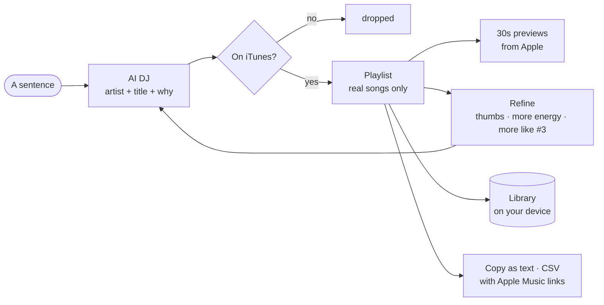

## A walk through

|                                                                                                                                                                                                                                                                                                                                                                                                                      |                                                                                                                                                                                                                                                                     |
| :------------------------------------------------------------------------------------------------------------------------------------------------------------------------------------------------------------------------------------------------------------------------------------------------------------------------------------------------------------------------------------------------------------------- | :------------------------------------------------------------------------------------------------------------------------------------------------------------------------------------------------------------------------------------------------------------------ |
| 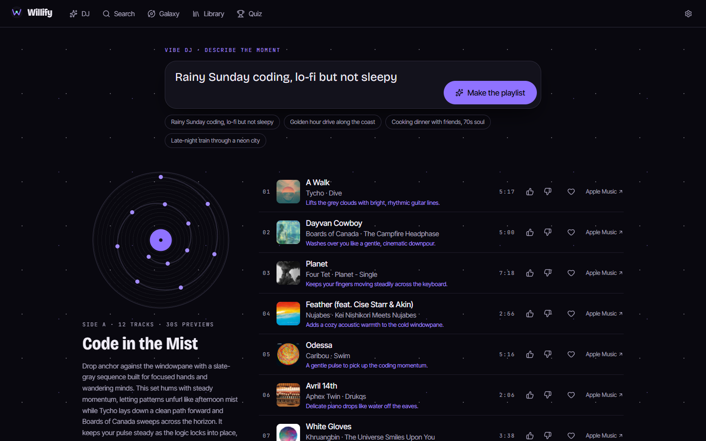 | 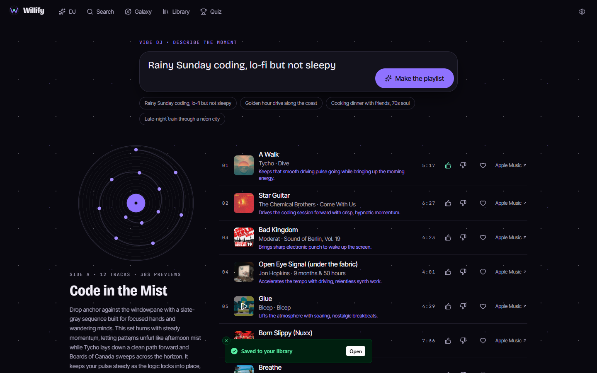                                               |
| **The Vibe DJ.** Every suggestion is checked against iTunes; the note under the sleeve says how many weren't there.                                                                                                                                                                                                                                                                                                  | **Refine.** Thumbs and a few words rework the list; songs you liked stay.                                                                                                                                                                                           |
| 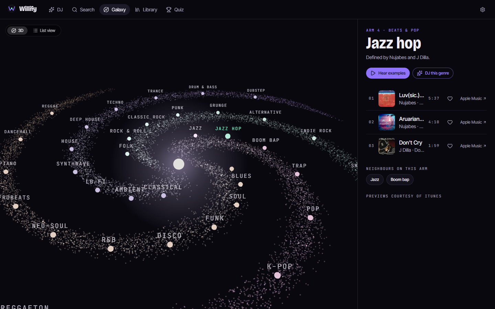                                                                                                                                                    | 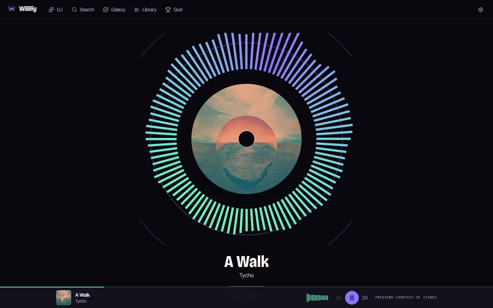 |
| **The genre galaxy.** Forty genres on four arms, neighbours sounding alike. Arrow keys move between stars; a list view is always there.                                                                                                                                                                                                                                                                              | **Now playing.** Bars driven by a Web Audio analyser. The badge and the credit never leave the screen.                                                                                                                                                              |
| 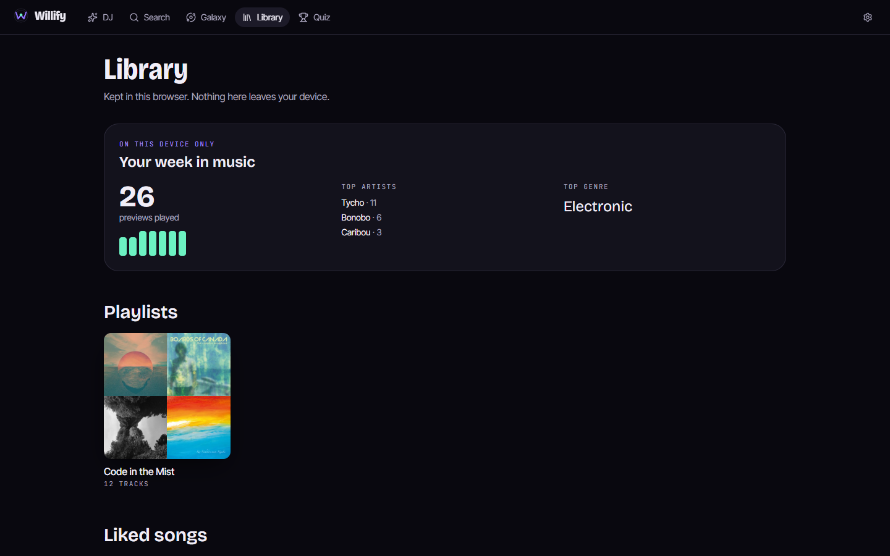                                                                                                                                                                     | 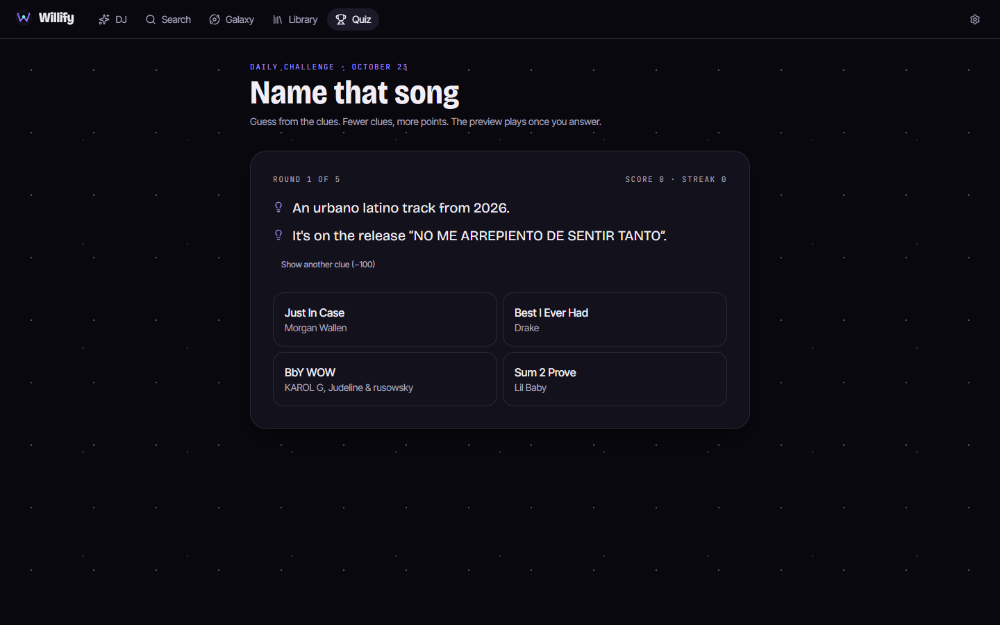                                                                                                 |
| **Library.** Playlists as sleeves, liked songs, and your week, from this device only.                                                                                                                                                                                                                                                                                                                                | **Name that song.** Clues first, fewer clues, more points; the preview plays at the reveal.                                                                                                                                                                         |
| 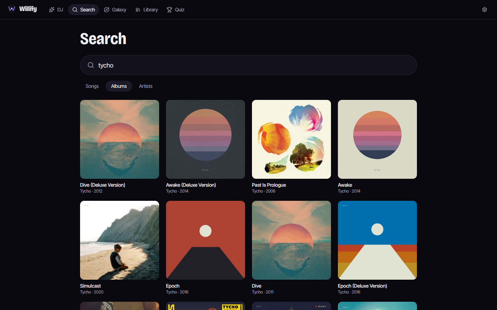                                                                                                                                                                                                                                                                                          | 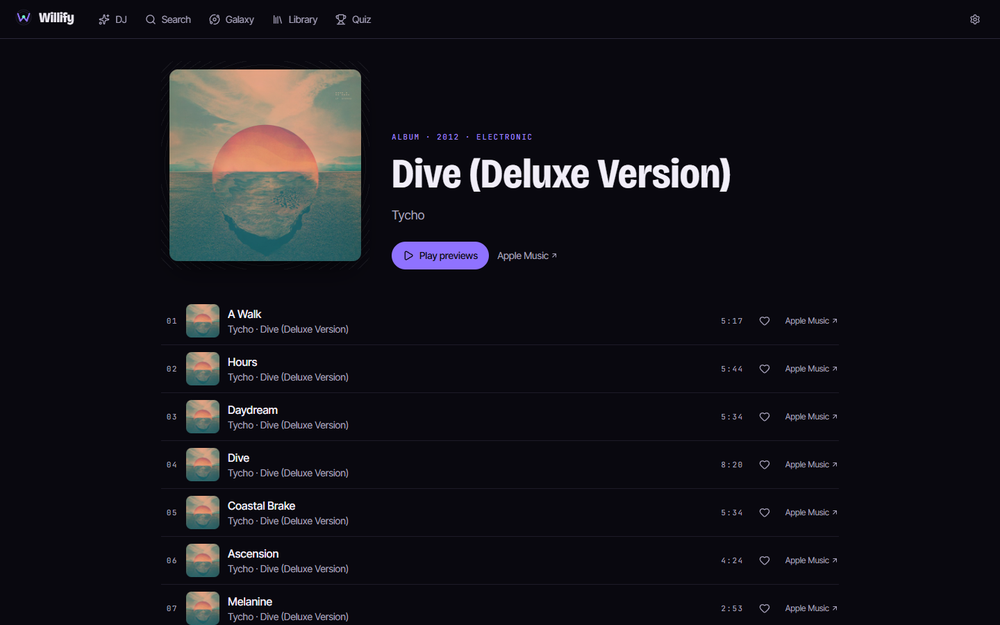                                                    |
| **Search.** Songs, albums and artists from Apple's catalogue.                                                                                                                                                                                                                                                                                                                                                        | **Album and artist pages.** Sleeves with the track list and a link to Apple Music.                                                                                                                                                                                  |
| 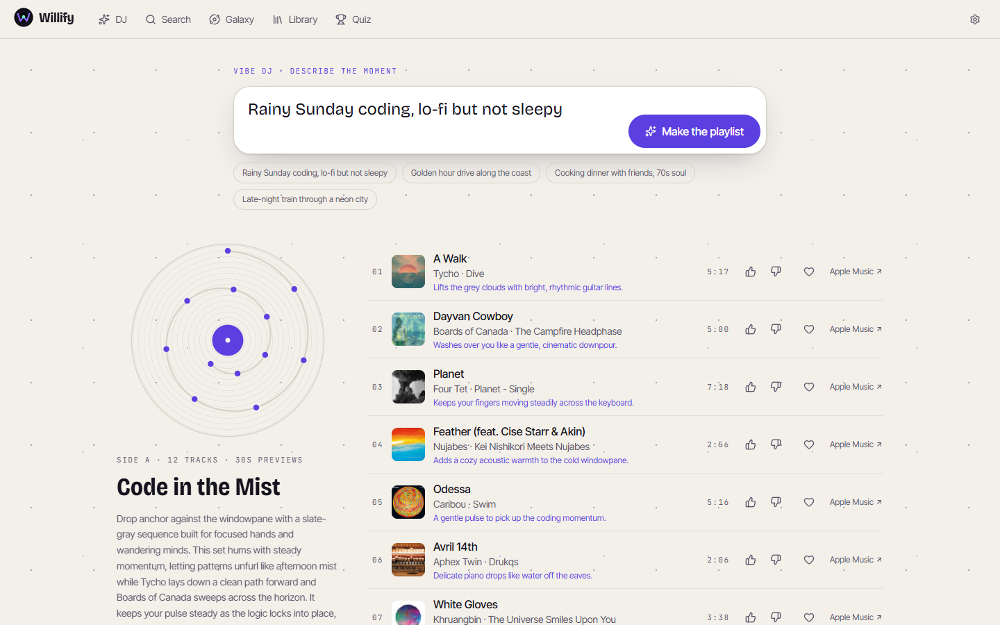                                                                                                                                                                                                                                                                                                               | 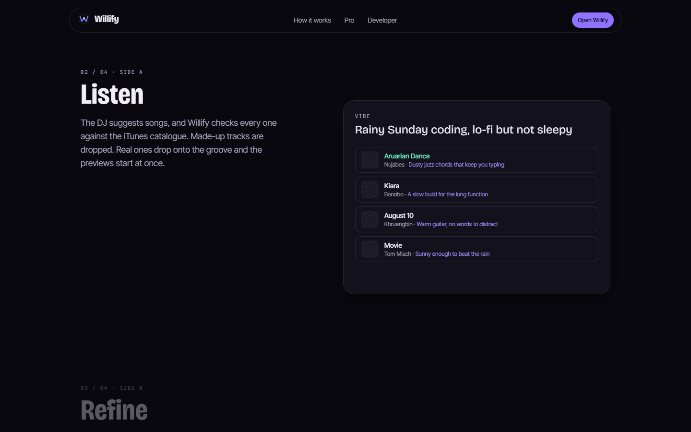                                                                     |
| **Sleeve theme.** Both themes pass WCAG AA on every page, checked by axe in CI.                                                                                                                                                                                                                                                                                                                                      | **The scroll story.** Describe, listen, refine, share, each with a live demo.                                                                                                                                                                                       |

<p align="center">
  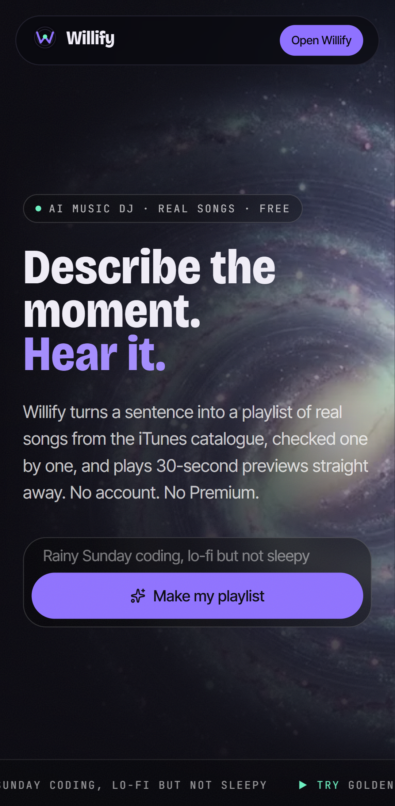
  &nbsp;
  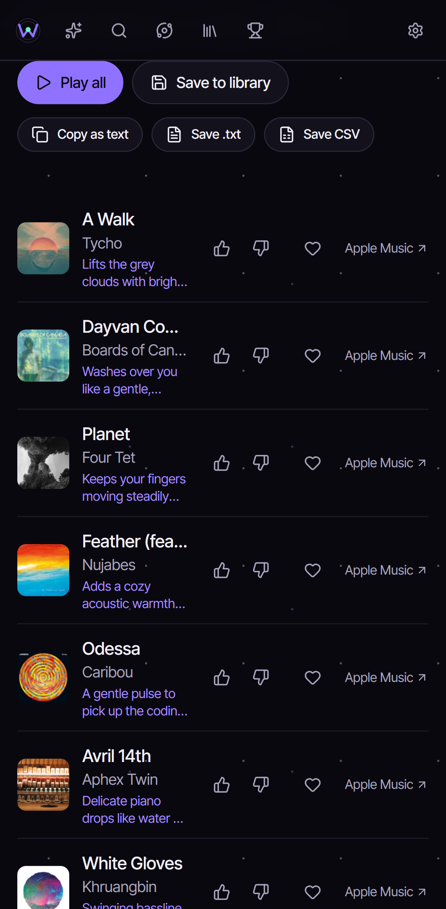
  &nbsp;
  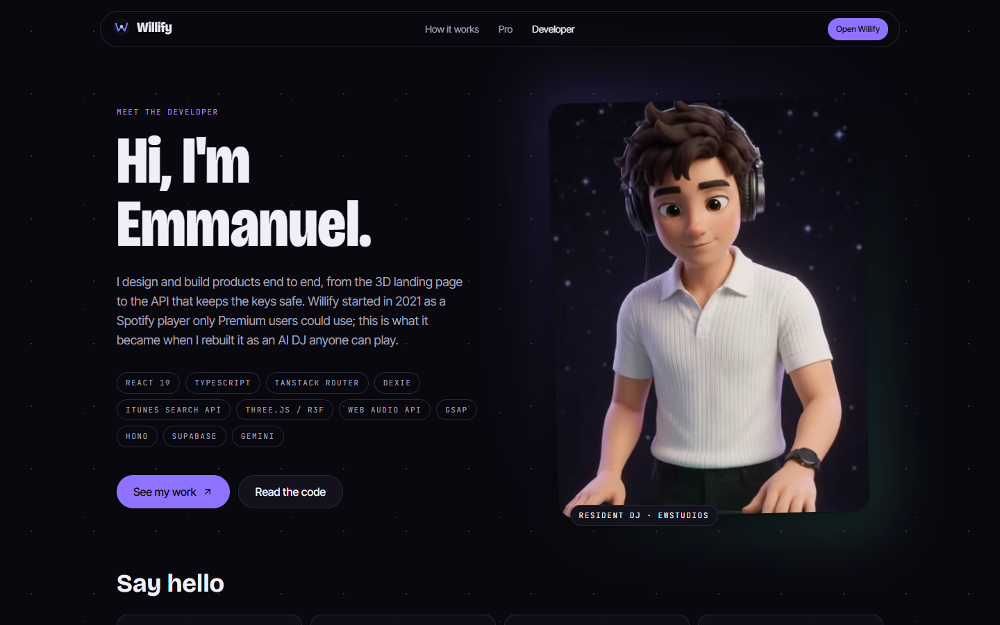
</p>

## How it is built

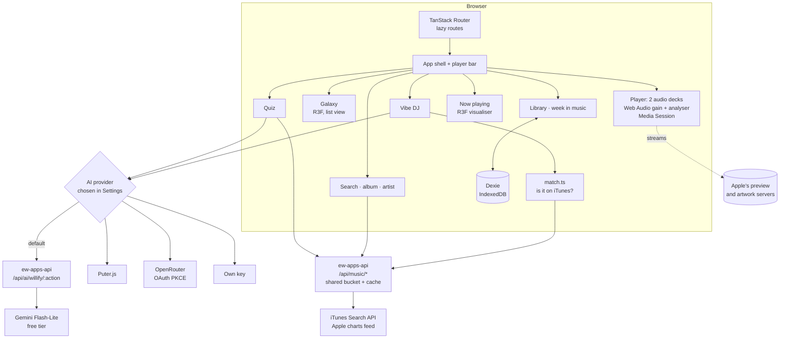

One playlist, from a sentence to sound:

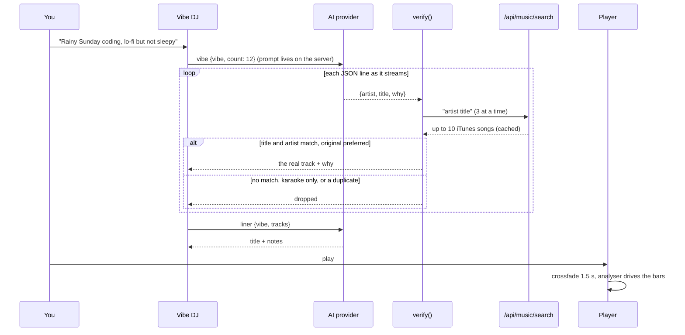

The iTunes route keeps Apple's 20-calls-a-minute rule for everyone at once:

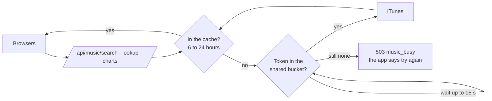

## Decisions worth explaining

- **The AI can't add a song that doesn't exist.** The model only suggests `artist`, `title` and a short `why`. `src/lib/match.ts` searches iTunes for each one, normalises both sides (accents, "feat.", "(Remastered 2011)", punctuation, "&"), and keeps a result only if the title and the main artist both match. Karaoke, tribute and "in the style of" recordings are refused unless asked for, and the original beats a remix or live take. On a real Gemini playlist 14 of 16 suggestions matched; the two that don't exist were dropped. The suggestions are checked as they stream in, three at a time, so the first songs appear while the AI is still writing.
- **Apple's terms shaped the interface.** Previews and artwork are promotional content: they must be streamed from Apple, never stored, sit next to a link where people can get the music, and say they are courtesy of iTunes. So every preview has Apple's official, unaltered "Listen on Apple Music" badge nearby (one per page, in the player bar or on now playing), every song has a text link to Apple Music, the credit is shown wherever previews play, and the service worker caches neither audio nor artwork. Apple Music links can carry a Performance Partners affiliate token from config (`VITE_APPLE_AFFILIATE_TOKEN`, empty by default).
- **The quiz is played on clues.** Apple allows previews only to promote the music, "not for entertainment purposes", so a guess-the-song-from-the-audio game was out. You guess from three AI clues (clues that contain a word of the answer are thrown away and replaced by the song's own details), and the preview plays at the reveal, next to the song's Apple Music link. The daily challenge is the same for everyone that day: a seeded shuffle of Apple's most-played chart.
- **No competitor buttons.** "Open in Spotify / YouTube Music" was considered. Apple's badge guidelines allow other services' badges after Apple's, but the preview terms say promotional content may not be used to promote other goods or services, so they were left out. Copy as text gives you the list to paste anywhere.
- **One iTunes budget for everyone.** iTunes Search needs no key but asks for about 20 calls a minute. Every call goes through ew-apps-api: a token bucket shared by all users (bursts queue for up to 15 seconds, then `503 music_busy`), an in-memory cache of the JSON for 6 to 24 hours, and lookups of up to 50 ids in one call (the chart's 50 songs cost one call). The browser also shares one request between pages asking the same thing.
- **Two decks, one analyser.** Each preview plays in its own `<audio>` element routed through Web Audio, so changing songs is a 1.5-second crossfade on gain nodes, not a cut. Apple's preview servers send `Access-Control-Allow-Origin: *`, so one `AnalyserNode` reads them directly for the visualiser and the galaxy's pulse, with no proxy. Media Session puts the controls on the lock screen and headphones.
- **Artwork at 600px, safely.** iTunes documents 100×100 artwork. The same CDN serves other sizes by name, so the app asks for 600×600 and falls back to the documented 100px image if that fails.
- **Prompts live on the server.** The API accepts data, never prompts: `vibe`, `refine`, `liner` and `hints` each have a server-side template, validated input with caps, a per-user daily quota and a per-IP limit. Only the vibe text and song names are sent; never anything personal.
- **The galaxy is a record.** The design idea: seen from above, a spiral galaxy looks like a vinyl record. Genres sit on four arms, playlists are drawn as grooves with a needle on the playing song, and the logo is a W whose middle peak lands on the label. See [docs/design-brief.md](docs/design-brief.md). The galaxy is 6,000 points in one draw call plus 38 genre stars; it loads after first paint, with a real GPU only, and never with reduced motion.
- **One sign-in for every EWSTUDIOS app.** All the apps share one Supabase account and live under `ewstudios.workers.dev`, so a passkey saved in one app signs you in to the others. The emailed 6-digit code always works. Sign-in exists only for the free AI server's quota; your library stays in the browser.

## Two versions

| Version           | Concept                                                                                               | Why it changed                                                                          |
| :---------------- | :---------------------------------------------------------------------------------------------------- | :-------------------------------------------------------------------------------------- |
| v1 (2021)         | A React 17 Spotify search and player, folded in with a MusicSearchApp that only `console.log`ged      | Premium-only playback, a hard-coded client ID, and a login server that no longer exists |
| **v2 (Oct 2026)** | An AI music DJ with checked iTunes songs, instant previews, a genre galaxy, a library and a clue quiz | Live                                                                                    |

## How it was made

Built in conversation with [Claude Code](https://claude.com/claude-code), which wrote and tested the code. The design direction came from Awwwards references (Overworld Audio, penguin.music, Byotōne, Pegassi's Ascension, VYBE Art; see [docs/design-brief.md](docs/design-brief.md)). The art and clips were generated in Google Flow (Nano Banana Pro and Omni 1.1 Flash); [docs/assets.md](docs/assets.md) lists every prompt. The logo and icons are SVG. Album artwork in the app and the screenshots always comes from iTunes; no AI image is passed off as a cover. The screenshots show real iTunes results and real Gemini answers to the server's own prompts.

## Run it

```bash
npm install
```

```bash
npm run dev
```

```bash
npm test
```

```bash
npm run e2e
```

Node 24. Copy `.env.example` to `.env` and point `VITE_API_URL` at a running [ew-apps-api](https://github.com/emwil23/ew-apps-api): it carries the iTunes search and the free AI option. Without an AI provider the DJ falls back to a plain iTunes search for your words. `npm run build` also prerenders the public pages, so it needs Playwright's Chromium (`npx playwright install chromium`). `npm run e2e` answers every iTunes call, image and AI request inside the test, so it needs no keys or network; it covers the AI playlist with a made-up song being dropped, refine, save, copy and CSV export, the player's badge and credit, search to album to artist, the galaxy's list view, the quiz reveal, and axe on every page in both themes. CI adds lint, typecheck and Lighthouse (≥ 0.95 in every category). Deploy with `VITE_API_URL=https://ewandtina-d9aa187632ca.herokuapp.com npm run build && npx wrangler deploy` (config in `wrangler.jsonc`).

`node scripts/screenshots.mjs` retakes the pictures in `docs/` against a served build, with real iTunes data from a local API and the recorded Gemini answers in `scripts/screenshot-fixtures.json`.

## Where things are

```
src/
├─ main.tsx              router.load(), then hydrate or render
├─ router.tsx            every route, lazily loaded
├─ index.css             design tokens for both themes, fonts, grooves, stars
├─ ai/                   actions + templates, providers, JSON Lines, PKCE, Supabase sign-in
├─ lib/                  music (iTunes client), match (is it real?), dj, quiz, galaxy, stats, exports, Dexie
├─ player/               the store and the Web Audio engine
├─ landing/              the scroll story, smooth scroll
├─ components/           shells, player bar, track rows, groove, galaxy scene, visualiser, Apple badge
└─ pages/                Landing, DJ, Search, Album, Artist, Galaxy, Library, Playlist, Quiz,
                         Now playing, Settings, Developer, Pro, Legal, 404
scripts/
├─ prerender.mjs         static HTML for the public pages
└─ screenshots.mjs       the README pictures
e2e/                     Playwright flows with mocked iTunes and AI hosts, and axe checks
docs/                    brief, design brief, asset list, screenshots
```

<div align="center">

Made with ♥ by EWSTUDIOS

</div>
